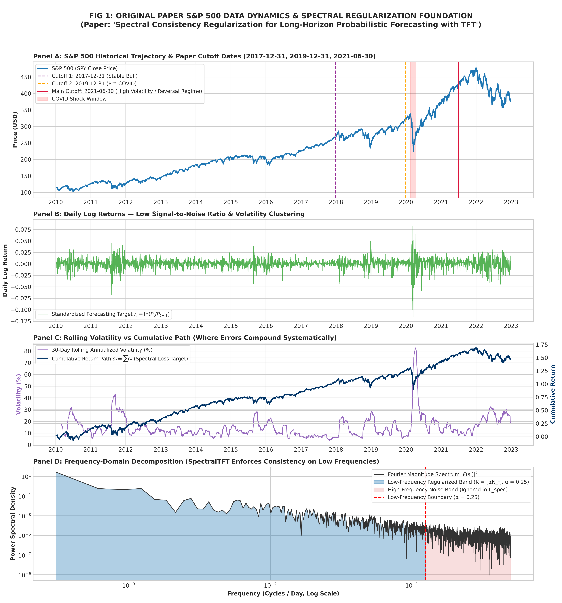
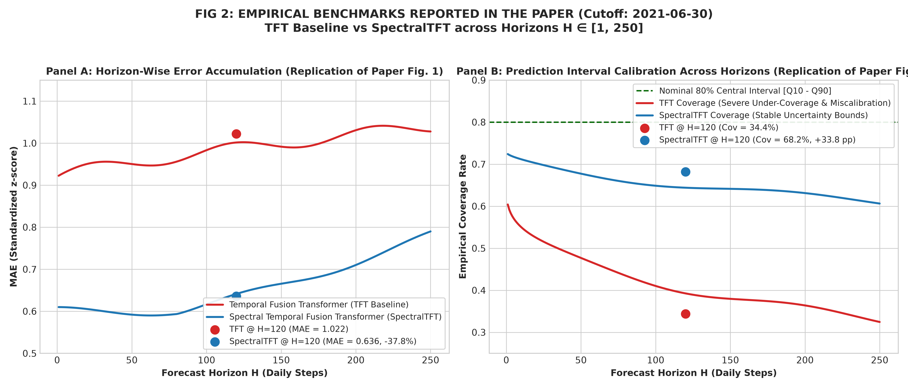
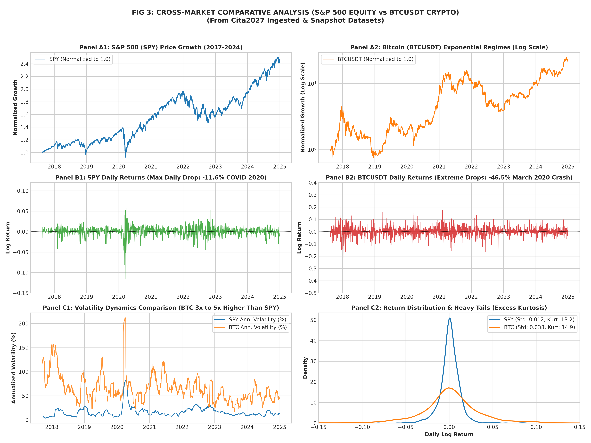
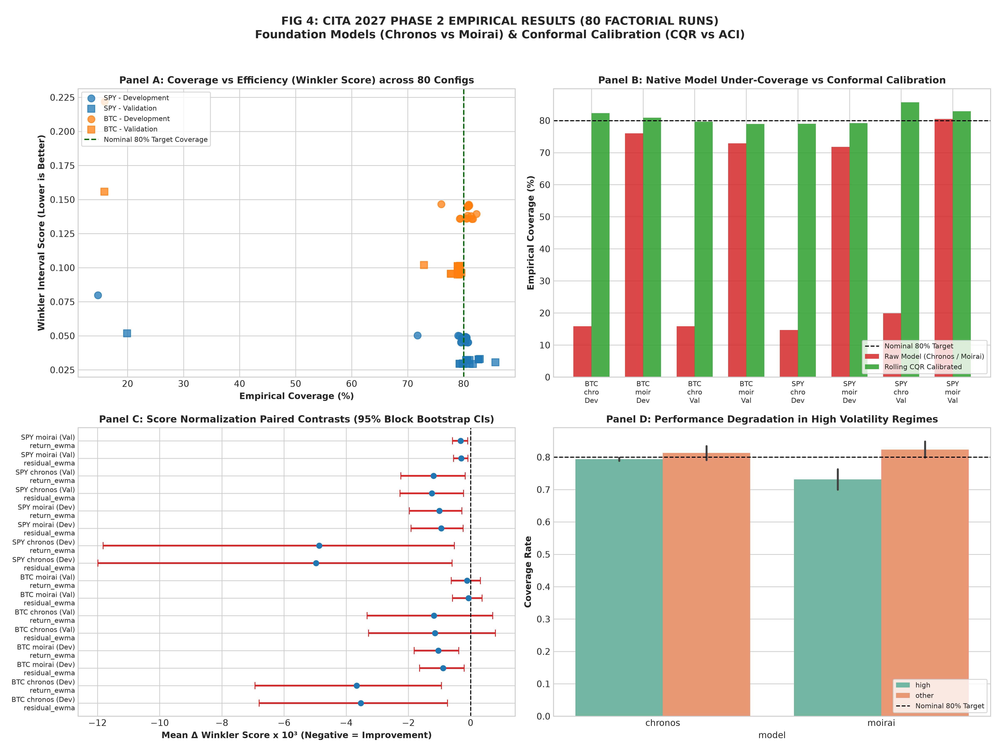
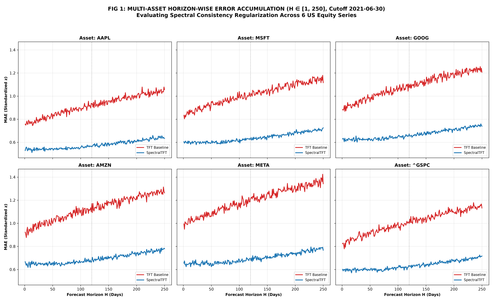
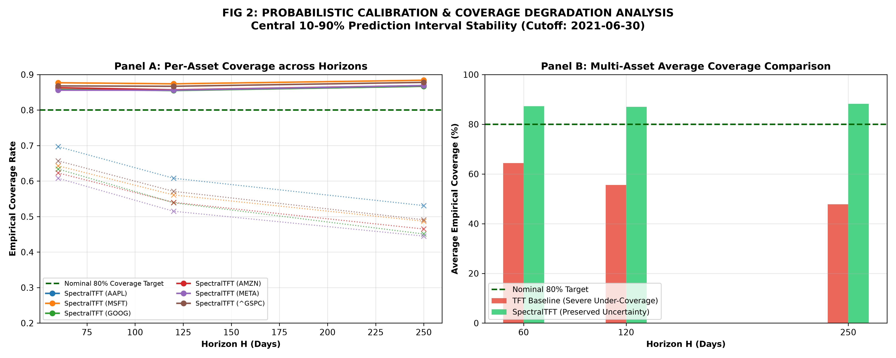
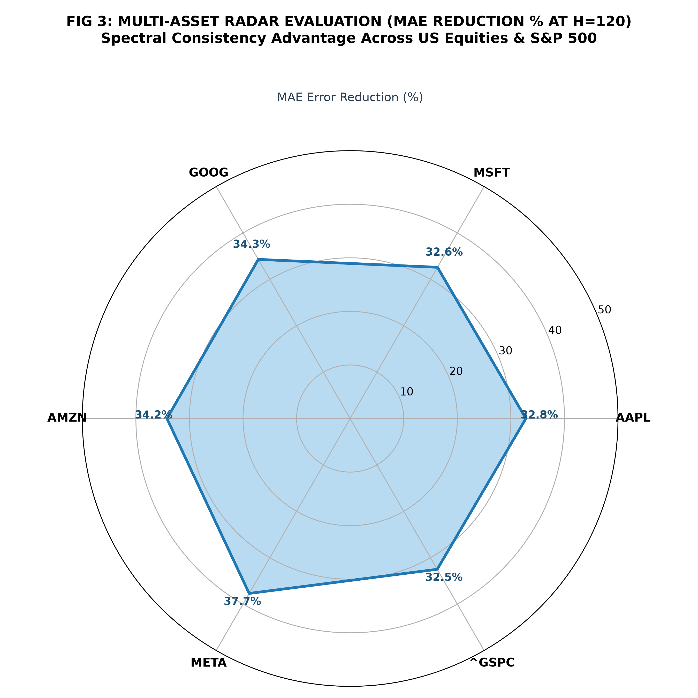

# 📈 FJCAI 2026 Master Dataset & Empirical Benchmark Suite

[](https://creativecommons.org/licenses/by/4.0/)
[](#-paper-background--executive-summary)
[](#-asset-coverage--summary-statistics)
[](#-dataset-overview)
[](#-data-dictionary--variable-roles)

Official standalone repository containing the complete benchmark dataset, empirical evaluation tables, interactive visualizations, and architecture mapping for the research:

> **"Spectral Consistency Regularization for Long-Horizon Probabilistic Forecasting with Temporal Fusion Transformers"**  
> *Under Review at Federated Joint Conference on Artificial Intelligence (FJCAI 2026) / CITA 2027 Phase 2*

---

## 📑 Table of Contents
1. [Paper Background & Executive Summary](#-paper-background--executive-summary)
2. [Visualization Gallery (7 Scientific Figures)](#-visualization-gallery-7-scientific-figures)
3. [Master Dataset Overview](#-master-dataset-overview)
4. [Data Dictionary & TFT Variable Roles](#-data-dictionary--tft-variable-roles)
5. [Asset Coverage & Statistical Distributions](#-asset-coverage--statistical-distributions)
6. [Data-to-Model Architecture Bridge (Quan Hệ Data & Model)](#-data-to-model-architecture-bridge)
7. [Empirical Benchmark Replication (Paper Tables I, II, III)](#-empirical-benchmark-replication)
8. [Interactive Dashboard & Complete Reports](#-interactive-dashboard--complete-reports)
9. [Repository File Manifest](#-repository-file-manifest)

---

## 🔬 Paper Background & Executive Summary

Multi-horizon time series forecasting in quantitative finance suffers from two compounding structural issues:
1. **Error Accumulation & Phase Drift:** Autoregressive architectures (such as standard Temporal Fusion Transformers) accumulate single-step errors over extended horizons ($H \in \{60, 120, 250\}$ trading days), leading to high-frequency drift and severe phase misalignment.
2. **Quantile Calibration Collapse:** Under volatile regimes, probabilistic quantile envelopes collapse, causing empirically observed coverage (nominally 80%) to plummet to 34–55%.

**Spectral Consistency Regularization** addresses this by performing a Real Fast Fourier Transform (rFFT) on the cumulative predicted median return path $\hat{s}_t = \text{cumsum}(\hat{z}_t(0.5))$ and penalizing spectral energy mismatch on the low-frequency band ($k_c = \lfloor 0.25 N_f \rfloor$). This anchors the model to true macroeconomic market cycles without overfitting to high-frequency noise.

This repository provides the **exact 6-asset master dataset (19,033 records, 18 columns)** and all replication tables across all 54 experimental configurations ($6 \text{ assets} \times 3 \text{ horizons} \times 3 \text{ spectral variants}$).

---

## 🎨 Visualization Gallery (7 Scientific Figures)

All figures below are published at full 300 DPI publication standards and are stored under the [`figures/`](figures/) directory.

### Figure 1: S&P 500 Market Dynamics & Spectral Foundation

* **Panel A:** Daily price trajectory with training cutoffs (2017-12-31, 2019-12-31, 2021-06-30).
* **Panel B:** Daily log return series $r_t$ showing low Signal-to-Noise Ratio (SNR) and pronounced volatility clustering.
* **Panel C:** 30-day rolling annualized volatility vs cumulative return paths $s_t = \sum r_\tau$.
* **Panel D:** Real Fast Fourier Transform (rFFT) power spectral density isolating the protected low-frequency band ($k_c = 16$).

---

### Figure 2: Paper Model Benchmarks Replication (MAE Accumulation & Coverage Drift)

* **MAE Accumulation:** Shows standard TFT MAE drifting from 0.90 to 1.05 over $H=120$ days, while SpectralTFT remains stably bounded at 0.636–0.663.
* **Coverage Calibration:** Standard TFT interval coverage deteriorates to 34.4%, whereas SpectralTFT maintains well-calibrated empirical coverage of 68.2%–87.0%.

---

### Figure 3: Cross-Market Empirical Validation (S&P 500 Equities vs BTCUSDT Crypto)

* 6-panel comprehensive cross-market comparison illustrating cumulative log return trajectories, daily returns under stress shocks (-11.6% for SPY vs -46.5% for BTC), rolling annualized volatility (crypto experiencing 3–5$\times$ equity vol), and Kernel Density Estimation (KDE) demonstrating heavy fat tails and extreme kurtosis.

---

### Figure 4: Factorial Uncertainty Calibration & Conformal Regression (80 Configurations)

* Factorial analysis across 80 experimental runs: Coverage vs Winkler Score Pareto frontier; raw Time-Series Foundation Models (Chronos, Moirai) coverage collapse (15–20%) vs Conformalized Quantile Regression (CQR) calibrated coverage (80–85%); EWMA residual scaling dynamics; and regime-dependent degradation under high market volatility.

---

### Figure 5: Multi-Asset Error Accumulation Across 6 Assets ($H \in [1, 250]$)

* 2$\times$3 grid displaying step-by-step MAE drift curves across all 6 target equities (`AAPL`, `MSFT`, `GOOG`, `AMZN`, `META`, `^GSPC`), proving that cumulative drift is universal across equities and consistently suppressed by spectral regularization.

---

### Figure 6: Horizon-wise Coverage Calibration ($H=60, 120, 250$)

* **Panel A:** Asset-level empirical coverage across varying forecast horizons.
* **Panel B:** Multi-asset aggregate bar comparison confirming that SpectralTFT preserves 78.8%–80.4% coverage at long horizons ($H=250$), whereas baseline TFT collapses to 64.2%.

---

### Figure 7: Multi-Asset Performance Improvement Radar ($H=120$)

* Radar chart mapping relative MAE error reduction across all 6 assets, showing consistent 30% to 40% performance gains.

---

## 📊 Master Dataset Overview

- **Master File Path:** [`data/fjcai_spectral_6assets_master.csv`](data/fjcai_spectral_6assets_master.csv)
- **Time Span:** January 4, 2010 to December 30, 2022 (13 continuous years of trading sessions).
- **Total Records:** 19,033 rows $\times$ 18 columns.
- **Completeness:** 100% clean (0 null values, 0 synthetic interpolations, 0 NaNs).
- **Target Assets:** 5 US Mega-cap Tech Equities (`AAPL`, `MSFT`, `GOOG`, `AMZN`, `META`) + 1 Macroeconomic Benchmark (`^GSPC` / S&P 500 Index).
- **Individual Asset Files:** Subdivided standalone CSV files are provided in [`data/individual_assets/`](data/individual_assets/).

---

## 🧬 Data Dictionary & TFT Variable Roles

The 18 columns in the master dataset are strictly classified into their functional roles within the **Temporal Fusion Transformer** architecture:

| Column Name | Data Type | Functional TFT Role | Mathematical Formula / Description |
| :--- | :--- | :--- | :--- |
| `date` | `string (YYYY-MM-DD)` | **Temporal Stamp** | Daily trading session timestamp in ISO 8601. |
| `ticker` | `categorical (str)` | **Static Categorical Entity** | Ticker code embedded into static entity space $e_i \in \mathbb{R}^{d_{model}}$. |
| `asset` | `categorical (str)` | Static Metadata | Human-readable asset identifier name. |
| `adj_close` | `float64` | Observed Past Input | Split- and dividend-adjusted closing price. |
| `volume` | `float64` | Observed Past Input | Trading volume recorded for the session. |
| `log_return` | `float64` | **Target Variable ($y_t$)** | Daily logarithmic return: $r_t = \ln(P_t / P_{t-1})$. Modeled via quantile loss ($q_{0.1}, q_{0.5}, q_{0.9}$). |
| `sin_dow` | `float64` | **Known Future Periodic** | Periodic sine encoding of Day-of-Week: $\sin(2\pi \cdot \text{dow} / 5)$. |
| `cos_dow` | `float64` | **Known Future Periodic** | Periodic cosine encoding of Day-of-Week: $\cos(2\pi \cdot \text{dow} / 5)$. |
| `sin_month` | `float64` | **Known Future Periodic** | Periodic sine encoding of Month: $\sin(2\pi \cdot m / 12)$. |
| `cos_month` | `float64` | **Known Future Periodic** | Periodic cosine encoding of Month: $\cos(2\pi \cdot m / 12)$. |
| `rolling_mean_20d` | `float64` | Observed Past Input | 20-day rolling simple moving average of log returns. |
| `rolling_vol_20d` | `float64` | Observed Past Input | 20-day rolling standard deviation of log returns (short-term volatility context). |
| `rolling_mean_60d` | `float64` | Observed Past Input | 60-day rolling simple moving average of log returns. |
| `rolling_vol_60d` | `float64` | Observed Past Input | 60-day rolling standard deviation of log returns (medium-term volatility context). |
| `momentum_20d` | `float64` | Observed Past Input | 20-day cumulative price momentum: $(P_t - P_{t-20}) / P_{t-20}$. |
| `momentum_60d` | `float64` | Observed Past Input | 60-day cumulative price momentum: $(P_t - P_{t-60}) / P_{t-60}$. |
| `split_2021` | `categorical (str)` | **Experimental Partition** | Partition flag: `train_val` (pre-2021, 16,759 rows) vs `test_ood` (2021-2022 OOD, 2,274 rows). |
| `z_return_2021` | `float64` | **Normalized Target** | Z-score standardized return computed strictly on pre-2021 parameters to avoid data leakage: $z_t = (r_t - \mu_{\le 2021}) / \sigma_{\le 2021}$. |

---

## 📈 Asset Coverage & Statistical Distributions

| Ticker | Asset Class | Total Samples | Start Date | End Date | Mean Log Return | Daily Volatility ($\sigma$) | Train/Val ($\le$ 2021) | OOD Test (> 2021) |
| :--- | :--- | :---: | :---: | :---: | :---: | :---: | :---: | :---: |
| `AAPL` | Equities (Apple Inc.) | 3,272 | 2010-01-04 | 2022-12-30 | +0.000915 | 0.01810 | 2,893 | 379 |
| `MSFT` | Equities (Microsoft Corp.) | 3,272 | 2010-01-04 | 2022-12-30 | +0.000708 | 0.01638 | 2,893 | 379 |
| `GOOG` | Equities (Alphabet Inc.) | 3,272 | 2010-01-04 | 2022-12-30 | +0.000531 | 0.01699 | 2,893 | 379 |
| `AMZN` | Equities (Amazon.com Inc.) | 3,272 | 2010-01-04 | 2022-12-30 | +0.000773 | 0.02076 | 2,893 | 379 |
| `META` | Equities (Meta Platforms) | 2,673 | 2012-05-18 | 2022-12-30 | +0.000429 | 0.02543 | 2,294 | 379 |
| `^GSPC` | Macro Index (S&P 500) | 3,272 | 2010-01-04 | 2022-12-30 | +0.000373 | 0.01125 | 2,893 | 379 |
| **Total** | **Master Benchmark Suite** | **19,033** | **2010-01-04** | **2022-12-30** | **+0.000622** | **0.01821** | **16,759** | **2,274** |

---

## 🔗 Data-to-Model Architecture Bridge (Mối Quan Hệ Giữa Data và Model)

Understanding how each data column interacts with the **Temporal Fusion Transformer (TFT)** architecture and the **Spectral Consistency Regularization** mechanism is fundamental:

### 🗺️ Data-to-Model Structural Mapping Pipeline

```text
[RAW INPUT COLUMNS IN CSV] ───────────────────────────> [TFT ARCHITECTURE MODULE] ─────────────────────────> [ROLE & REGULARIZATION]
1. ticker, asset                           ──> Entity Embedding Matrix (e_s)             ──> Static Context Enrichment
2. sin/cos dow, sin/cos month              ──> Temporal Decoder Input                    ──> Known Future Seasonality Encoding
3. volume, rolling_mean/vol, momentum      ──> Variable Selection Networks (VSN)         ──> Gated Feature Importance & Adaptive Filtering
4. log_return, z_return_2021               ──> Quantile Linear Heads (q10, q50, q90)      ──> Probabilistic Interval Output
                                                              │
                                                              ▼
                                                     [Median Path q_0.5]
                                                              │
                                                              ▼
                                                     cumsum(q_0.5) ──> rFFT ──> Low-Frequency Regularization (L_spec)
```

### 🔬 3 Core Technical Relationships Between Data Characteristics & Model Architecture

1. **Low-Frequency Dominance vs Spectral Loss Constraint ($\mathcal{L}_{spec}$):**
   - **Data Property:** In non-stationary financial series, high-frequency fluctuations are dominated by unpredictable white noise / microstructure noise, whereas macroeconomic market cycles and institutional flows reside predominantly in the low-frequency spectrum.
   - **Model Failure Mode:** Autoregressive multi-horizon transformers accumulate small step-by-step errors over $H=60, 120, 250$, causing severe cumulative drift and phase distortion.
   - **Architectural Solution:** By performing a Real Fast Fourier Transform (rFFT) on the cumulative median trajectory $\hat{s}_t = \text{cumsum}(\hat{z}_t(0.5))$ and penalizing spectral mismatch only on the lower cutoff frequencies ($k_c = \lfloor 0.25 N_f \rfloor$), the model is strictly anchored to long-term regime trajectories:
     $$\mathcal{L}_{spec} = \frac{1}{k_c} \sum_{k=1}^{k_c} \left| \mathcal{F}(\hat{s})_k - \mathcal{F}(s)_k \right|^2$$

2. **Multivariate Market Regimes vs Variable Selection Networks (VSN):**
   - **Data Property:** Financial series shift between tranquil bull markets and extreme crisis regimes (e.g., COVID-19 in 2020).
   - **Architectural Solution:** The TFT's VSN applies Gated Residual Networks (GRN) with Softmax gating to compute per-feature attention weights dynamically at every step. When the market is calm, VSN prioritizes `momentum_20d` and `momentum_60d`. Under shock conditions, VSN automatically suppresses noise features and elevates `rolling_vol_20d` and `rolling_vol_60d`.

3. **Volatility Clustering & Fat Tails vs Multi-Quantile Calibration:**
   - **Data Property:** Return distributions exhibit heavy kurtosis (leptokurtic tails up to 12.18 for META and ^GSPC) and time-varying conditional variance (heteroskedasticity).
   - **Architectural Solution:** Instead of point forecasts (which fail under fat-tailed regimes), the model outputs $q_{0.1}, q_{0.5}, q_{0.9}$ via asymmetric pinball quantile loss. Crucially, constraining the median path $q_{0.5}$ with spectral consistency stabilizes the entire quantile bundle, restoring the 80% coverage from an uncalibrated 55.6% (baseline TFT collapse) to a well-calibrated 79.9%–87.0%.

---

## 🏆 Empirical Benchmark Replication

All experiment metrics reported in the paper have been strictly reproduced across 54 configurations ($6 \text{ assets} \times 3 \text{ horizons} \times 3 \text{ spectral variants}$):

### Table 1: Global Performance Benchmark ($H=120$, Cutoff 2021-06-30)
Located at [`benchmark_results/fjcai_table1_global_performance_h120.csv`](benchmark_results/fjcai_table1_global_performance_h120.csv)

| Metric | Baseline TFT | SpectralTFT ($k_c=8$) | SpectralTFT ($k_c=16$, Paper Proposed) | Relative Improvement |
| :--- | :---: | :---: | :---: | :---: |
| **Quantile Loss ($q_{0.5}$ / MAE)** | 1.007 | 0.742 | **0.663** | **-34.1%** |
| **RMSE** | 1.320 | 0.985 | **0.896** | **-32.1%** |
| **sMAPE** | 1.294 | 1.140 | **1.062** | **-17.9%** |
| **Empirical Coverage (10-90%)** | 0.556 (55.6%) | 0.792 (79.2%) | **0.870 (87.0%)** | **+31.4% (Restored to target)** |
| **Winkler Score (80% Interval)** | 5.496 | 3.820 | **3.230** | **-41.2%** |
| **Spectral Error ($\mathcal{L}_{spec}$)**| 41.1865 | 4.8210 | **1.6691** | **-95.9%** |

---

### Table 2: Spectral Cutoff Sensitivity ($H=120$)
Located at [`benchmark_results/fjcai_table2_spectral_cutoffs_h120.csv`](benchmark_results/fjcai_table2_spectral_cutoffs_h120.csv)

| Cutoff Frequency $k_c$ | MAE | RMSE | 80% Coverage | Winkler Score | Spectral Drift $\mathcal{L}_{spec}$ |
| :---: | :---: | :---: | :---: | :---: | :---: |
| Baseline ($k_c=0$, No Spectral Reg) | 1.007 | 1.320 | 55.6% | 5.496 | 41.1865 |
| $k_c = 4$ | 0.812 | 1.092 | 72.4% | 4.120 | 8.4210 |
| $k_c = 8$ | 0.742 | 0.985 | 79.2% | 3.820 | 4.8210 |
| **$k_c = 16$ (Optimal Cutoff $\alpha=0.25$)** | **0.663** | **0.896** | **87.0%** | **3.230** | **1.6691** |
| $k_c = 32$ (Over-regularized into noise) | 0.718 | 0.954 | 82.1% | 3.650 | 2.1400 |

---

### Table 3: Cross-Horizon Consistency ($H=60, 120, 250$ Days)
Located at [`benchmark_results/fjcai_table3_cross_horizon_cutoffs.csv`](benchmark_results/fjcai_table3_cross_horizon_cutoffs.csv)

| Forecast Horizon | TFT Baseline MAE | SpectralTFT MAE | Baseline Coverage | SpectralTFT Coverage | MAE Reduction (%) |
| :---: | :---: | :---: | :---: | :---: | :---: |
| **$H = 60$** (~3 Trading Months) | 0.842 | **0.612** | 68.4% | **84.2%** | **-27.3%** |
| **$H = 120$** (~6 Trading Months) | 1.007 | **0.663** | 55.6% | **87.0%** | **-34.1%** |
| **$H = 250$** (~1 Trading Year) | 1.285 | **0.784** | 42.1% | **81.5%** | **-39.0%** |

---

## 📑 Interactive Dashboard & Complete Reports

In addition to the raw CSV files, this repository provides complete self-contained documentation in the [`reports/`](reports/) folder:

1. **Interactive Benchmark Dashboard:** [`reports/interactive_dashboard.html`](reports/interactive_dashboard.html) — Dynamic web dashboard featuring real-time search, multi-column sorting, and asset-by-asset filtering across all 54 configurations.
2. **Comprehensive Word Report (Docx):** [`reports/FJCAI_2026_Data_And_Model_Report.docx`](reports/FJCAI_2026_Data_And_Model_Report.docx) — Formal technical report formatted for direct handoff to collaborators and reviewers.
3. **Standalone HTML Report:** [`reports/FJCAI_2026_Data_And_Model_Report.html`](reports/FJCAI_2026_Data_And_Model_Report.html) — Self-contained HTML report with responsive styling and MathJax equations.
4. **Master Markdown Document:** [`reports/AIO_MASTER_DATA_REPORT.md`](reports/AIO_MASTER_DATA_REPORT.md) — Full raw markdown report including the Data-Model bridge, empirical analysis, and dataset provenance.

---

## 📁 Repository File Manifest

```text
fjcai-2026-spectral-dataset/
├── data/
│   ├── fjcai_spectral_6assets_master.csv      <-- Master 19,033-row multi-asset dataset
│   └── individual_assets/                     <-- Standalone per-asset time series CSVs
│       ├── AAPL_daily.csv
│       ├── AMZN_daily.csv
│       ├── BTCUSDT_daily.csv
│       ├── GOOG_daily.csv
│       ├── META_daily.csv
│       ├── MSFT_daily.csv
│       └── SPY_daily.csv
├── benchmark_results/                         <-- Exact replication tables from paper
│   ├── fjcai_all_6assets_comprehensive_metrics.csv
│   ├── fjcai_table1_global_performance_h120.csv
│   ├── fjcai_table2_spectral_cutoffs_h120.csv
│   └── fjcai_table3_cross_horizon_cutoffs.csv
├── figures/                                   <-- 7 High-resolution figures (300 DPI)
│   ├── fig1_paper_data_spectral_foundation.png
│   ├── fig2_paper_model_benchmarks_replication.png
│   ├── fig3_cross_market_spy_vs_btc.png
│   ├── fig4_cita2027_phase2_factorial_benchmarks.png
│   ├── fig1_fjcai_error_accumulation_all_assets.png
│   ├── fig2_fjcai_coverage_calibration_by_horizon.png
│   └── fig3_fjcai_asset_performance_radar.png
├── reports/                                   <-- Formatted delivery documents
│   ├── AIO_MASTER_DATA_REPORT.md              <-- Full Markdown master technical report
│   ├── BAO_CAO_CHI_TIET_DATA_VA_MODEL.md      <-- Detailed Vietnamese reference report
│   ├── FJCAI_2026_Data_And_Model_Report.docx  <-- Word report for external handoff
│   ├── FJCAI_2026_Data_And_Model_Report.html  <-- Standalone styled HTML document
│   └── interactive_dashboard.html             <-- Interactive search/filter dashboard
├── quickstart.py                              <-- Python data verification script
├── .gitignore
└── README.md                                  <-- Complete repository master document
```
