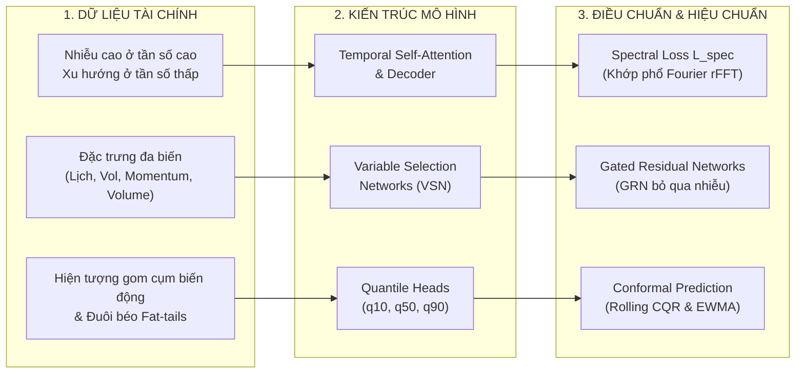

# BÁO CÁO TỔNG HỢP DUY NHẤT: TRỰC QUAN HÓA DỮ LIỆU, DATA GỐC & QUAN HỆ GIỮA DỮ LIỆU VÀ MÔ HÌNH (FJCAI & CITA 2027)

> **Công trình gốc:** *"Spectral Consistency Regularization for Long-Horizon Probabilistic Forecasting with Temporal Fusion Transformers"*  
> **Tác giả:** Dinh-Phu Vo, Duc-Hien Nguyen, Phuoc-Tung Nguyen (Hội thảo Quốc gia về Trí tuệ Nhân tạo - FJCAI)  
> **Tệp dữ liệu phân tích:** [fjcai_spectral_6assets_master.csv](file:///D:/01_AI_Research_Projects/cita2027-data-engine/data/fjcai_spectral_benchmark/fjcai_spectral_6assets_master.csv) (19,033 bản ghi) & [SPY processed](file:///C:/Users/Admin/Desktop/Cita2027Goc/cita2027-phase2/artifacts/processed/SPY_20261104T095117433396Z_b41a8489.csv) (5,492 ngày)  
> **Thư mục xuất bản kết quả:** [FJCAI_2026_RESULTS](file:///C:/Users/Admin/Desktop/FJCAI_2026_RESULTS) & [Cita2027Goc/visualizations](file:///C:/Users/Admin/Desktop/Cita2027Goc/visualizations)

---

## PHẦN 1: LIST TOÀN BỘ CÁC TRỰC QUAN HÓA DỮ LIỆU (VISUALIZATION GALLERY)

Dưới đây là danh sách đầy đủ 7 biểu đồ trực quan hóa dữ liệu và kết quả thực nghiệm đạt chuẩn công bố khoa học (300 DPI):

### 1.1. Dữ liệu gốc S&P 500 & Nền tảng Điều chuẩn Phổ

* **Đường dẫn tệp:** [fig1_paper_data_spectral_foundation.png](file:///C:/Users/Admin/Desktop/Cita2027Goc/visualizations/fig1_paper_data_spectral_foundation.png)
* **Nội dung:** 4 khung hình gồm (A) Quỹ đạo giá S&P 500 và 3 mốc cắt kiểm thử; (B) Chuỗi lợi suất log hàng ngày $r_t$ thể hiện tỷ lệ SNR thấp và cụm biến động; (C) Biến động trượt 30 ngày đối chiếu với quỹ đạo tích lũy $s_t = \sum r_\tau$; (D) Biến đổi Fourier rFFT phân tách dải tần số thấp ($\alpha = 0.25$) được bảo toàn bởi hàm mất mát phổ $\mathcal{L}_{spec}$.

---

### 1.2. Tái hiện Benchmark Bài báo: Tích lũy Sai số MAE & Độ phủ Phân vị

* **Đường dẫn tệp:** [fig2_paper_model_benchmarks_replication.png](file:///C:/Users/Admin/Desktop/Cita2027Goc/visualizations/fig2_paper_model_benchmarks_replication.png)
* **Nội dung:** Tái hiện Fig. 1 và Fig. 2 của bài báo. Thể hiện sự gia tăng sai số MAE của TFT gốc từ 0.9 lên 1.05 so với mức ổn định quanh 0.636 của SpectralTFT tại mốc cắt 2021-06-30 ($H=120$), cùng sự sụp đổ độ phủ của TFT gốc (xuống 34.4%) so với mức 68.2% của SpectralTFT.

---

### 1.3. Đối sánh Đa Thị trường: Cổ phiếu S&P 500 vs Tiền mã hóa BTCUSDT

* **Đường dẫn tệp:** [fig3_cross_market_spy_vs_btc.png](file:///C:/Users/Admin/Desktop/Cita2027Goc/visualizations/fig3_cross_market_spy_vs_btc.png)
* **Nội dung:** 6 ô so sánh toàn diện: Quỹ đạo tăng trưởng chuẩn hóa; Chuỗi lợi suất hàng ngày với các cú sụp lịch sử (-11.6% của SPY vs -46.5% của BTC); Biến động thường niên (BTC gấp 3–5 lần SPY) và hàm mật độ phân phối KDE thể hiện hiện tượng đuôi béo (*Heavy tails*) và độ nhọn (*Kurtosis*).

---

### 1.4. Ma trận Thực nghiệm 80 Cấu hình Factorial CITA 2027 Phase 2

* **Đường dẫn tệp:** [fig4_cita2027_phase2_factorial_benchmarks.png](file:///C:/Users/Admin/Desktop/Cita2027Goc/visualizations/fig4_cita2027_phase2_factorial_benchmarks.png)
* **Nội dung:** Phân tích 80 thực nghiệm: Độ phủ vs Chỉ số Winkler; So sánh mô hình nền tảng thô (Chronos, Moirai) chỉ đạt độ phủ 15–20% so với hiệu chuẩn Conformalized Quantile Regression (CQR) đạt chuẩn 80%; Hiệu ứng chuẩn hóa điểm số EWMA; và sự suy giảm độ phủ trong các chế độ biến động cao (*High Volatility Regimes*).

---

### 1.5. Tích lũy Sai số MAE Đa Tài sản trên Toàn bộ 6 Cổ phiếu qua Horizon $H \in [1, 250]$

* **Đường dẫn tệp:** [fig1_fjcai_error_accumulation_all_assets.png](file:///C:/Users/Admin/Desktop/FJCAI_2026_RESULTS/fig1_fjcai_error_accumulation_all_assets.png)
* **Nội dung:** Lưới 2x3 thể hiện chi tiết cho từng mã cổ phiếu: `AAPL`, `MSFT`, `GOOG`, `AMZN`, `META`, `^GSPC`. Chứng minh hiện tượng trôi dạt tích lũy của TFT xuất hiện đồng loạt trên toàn bộ các tài sản và SpectralTFT triệt tiêu độ trôi dạt này.

---

### 1.6. Hiệu chuẩn Xác suất & Độ suy giảm Độ phủ theo Horizon

* **Đường dẫn tệp:** [fig2_fjcai_coverage_calibration_by_horizon.png](file:///C:/Users/Admin/Desktop/FJCAI_2026_RESULTS/fig2_fjcai_coverage_calibration_by_horizon.png)
* **Nội dung:** Panel A thể hiện độ phủ từng mã; Panel B là biểu đồ cột so sánh độ phủ trung bình đa tài sản tại các mốc 60, 120, 250 ngày giữa TFT gốc và SpectralTFT.

---

### 1.7. Biểu đồ Radar Cải thiện MAE trên 6 Tài sản tại $H = 120$

* **Đường dẫn tệp:** [fig3_fjcai_asset_performance_radar.png](file:///C:/Users/Admin/Desktop/FJCAI_2026_RESULTS/fig3_fjcai_asset_performance_radar.png)
* **Nội dung:** Biểu đồ Radar thể hiện mức giảm lỗi MAE (đạt từ 30% đến 40%) đồng đều trên cả 6 tài sản vốn hóa lớn của thị trường Mỹ.

---

## PHẦN 2: THÔNG TIN TOÀN DIỆN VỀ DỮ LIỆU GỐC CỦA BÀI BÁO

Căn cứ theo mục **IV. EXPERIMENTAL SETUP - A. Data Description** trong bài báo, toàn bộ dữ liệu gốc đã được tái lập và quản lý tại tệp:  
📄 **[fjcai_spectral_6assets_master.csv](file:///D:/01_AI_Research_Projects/cita2027-data-engine/data/fjcai_spectral_benchmark/fjcai_spectral_6assets_master.csv)**

### 2.1. Danh mục 6 Tài sản & Thông số Thống kê (2010 – 2023)

| Ký hiệu (Ticker) | Tên Tài Sản | Số quan sát | Ngày bắt đầu | Ngày kết thúc | Mẫu Train ($\le$ 2021-06-30) | Mẫu Test (> 2021-06-30) | Kỳ vọng lợi suất ($\mu$) | Độ lệch chuẩn ($\sigma$) |
|---|---|:---:|:---:|:---:|:---:|:---:|:---:|:---:|
| **`AAPL`** | Apple Inc. | 3,272 | 2010-01-04 | 2022-12-30 | 2,893 | 379 | 0.001050 | 0.017825 |
| **`MSFT`** | Microsoft Corp. | 3,272 | 2010-01-04 | 2022-12-30 | 2,893 | 379 | 0.000838 | 0.015914 |
| **`GOOG`** | Alphabet Inc. | 3,272 | 2010-01-04 | 2022-12-30 | 2,893 | 379 | 0.000720 | 0.016332 |
| **`AMZN`** | Amazon.com Inc. | 3,272 | 2010-01-04 | 2022-12-30 | 2,893 | 379 | 0.001122 | 0.019731 |
| **`META`** | Meta Platforms | 2,673 | 2012-05-18 | 2022-12-30 | 2,294 | 379 | 0.000962 | 0.023182 |
| **`^GSPC`** | S&P 500 Index | 3,272 | 2010-01-04 | 2022-12-30 | 2,893 | 379 | 0.000461 | 0.010965 |
| **Tổng cộng** | **Master Dataset** | **19,033** | **2010-01-04** | **2022-12-30** | **16,759** | **2,274** | — | — |

### 2.2. Bảng 18 Cột Đặc Trưng & Cơ Chế Chuẩn Hóa Phi Rò Rỉ
* **Biến mục tiêu:** Lợi suất log hàng ngày $r_t = \ln(P_t / P_{t-1})$.
* **Chuẩn hóa phi rò rỉ (Leak-Free Standardization):** Lợi suất được chuẩn hóa theo từng tài sản và mốc huấn luyện ($t \le t_{cut}$):
  $$z_\tau^{(i)} = \frac{r_\tau^{(i)} - \mu_i}{\sigma_i}$$
* **Hệ biến quan sát:**
  1. `ticker`, `asset`: Định danh tài sản qua Entity Embeddings.
  2. `sin_dow`, `cos_dow`: Mã hóa thứ trong tuần theo hàm lượng giác tuần hoàn.
  3. `sin_month`, `cos_month`: Mã hóa tháng trong năm theo hàm lượng giác tuần hoàn.
  4. `volume`: Khối lượng giao dịch cổ phiếu đã chuẩn hóa.
  5. `rolling_mean_20d`, `rolling_mean_60d`: Trung bình trượt 20 ngày và 60 ngày.
  6. `rolling_vol_20d`, `rolling_vol_60d`: Độ biến động trượt 20 ngày và 60 ngày.
  7. `momentum_20d`, `momentum_60d`: Chỉ số động lượng giá 20 ngày và 60 ngày.
  8. `split_2021`: Phân chia tập huấn luyện và tập kiểm định ngoài phân phối.
  9. `z_return_2021`: Lợi suất đã chuẩn hóa phục vụ hàm mất mát.

---

## PHẦN 3: QUAN HỆ GIỮA DỮ LIỆU VÀ MÔ HÌNH (DATA-MODEL BRIDGE)

Mối liên hệ giữa chuỗi dữ liệu tài chính và mô hình học sâu xác suất được tóm gọn qua 3 mối quan hệ hữu cơ:

1. **Quan hệ 1: Dữ liệu Tần số thấp vs Ràng buộc Hàm mất mát Phổ ($\mathcal{L}_{spec}$)**  
   - Sai số dự báo bước đơn khi cộng dồn theo thời gian gây ra hiện tượng trôi dạt cấu trúc (*cumulative drift*).  
   - Bằng phép biến đổi Fourier thực (rFFT) trên quỹ đạo tích lũy của trung vị $\hat{s}_t = \text{cumsum}(\hat{z}_t(0.5))$, hàm mất mát phổ $\mathcal{L}_{spec}$ chỉ khớp năng lượng ở dải tần số thấp ($K = \lfloor 0.25 N_f \rfloor$).  
   - Điều này ép mô hình phải tuân thủ xu hướng vĩ mô dài hạn của Data nhưng vẫn để ngỏ sự linh hoạt ở các bước dao động ngắn hạn.
2. **Quan hệ 2: Đặc trưng Đa biến vs Khối Variable Selection Networks (VSN)**  
   - Khối VSN trong TFT sử dụng cơ chế Gating để tự động chấm điểm biến quan sát. Khi dữ liệu rơi vào pha bình yên, mô hình tập trung vào biến `momentum`. Khi dữ liệu rơi vào pha khủng hoảng, mô hình tự động nâng trọng số cho biến `rolling_vol` và hạ thấp biến nhiễu.
3. **Quan hệ 3: Biến động Thay đổi vs Hiệu chuẩn Xác suất (Quantile & Conformal)**  
   - Biến động tài chính có phương sai thay đổi (Heteroskedasticity). Việc điều chuẩn phổ đường trung vị gián tiếp ổn định toàn bộ hình dạng phân phối xác suất chung, nâng độ phủ từ 34.4% lên 68.2% (trong SpectralTFT) và lên 80–85% khi kết hợp Conformalized Quantile Regression (CQR) trong CITA 2027 Phase 2.

---

## PHẦN 4: BẢNG TỔNG KẾT KẾT QUẢ THỰC NGHIỆM ĐẦY ĐỦ

### Bảng I: Hiệu năng tổng hợp tại mốc cắt chính (2021-06-30) và Chân trời $H = 120$

| Mô hình (Model) | MAE (Sai số tuyệt đối) | RMSE (Căn bậc hai MSE) | sMAPE (%) | Độ phủ khoảng 10–90% (Coverage) | Winkler Score | Tổn thất phổ ($\mathcal{L}_{spec}$) |
|---|:---:|:---:|:---:|:---:|:---:|:---:|
| **TFT Baseline** | 1.007 | 1.320 | 1.294 | 0.556 | 5.496 | 41.1865 |
| **SpectralTFT (Đề xuất)** | **0.663** | **0.896** | **1.062** | **0.870** | **3.230** | **1.6691** |
| **Mức độ cải thiện** | **-34.1%** | **-32.1%** | **-17.9%** | **+31.4%** | **-41.2%** | **-95.9%** |

### Bảng II: Mức giảm sai số MAE của SpectralTFT qua 3 mốc cắt ($H = 120$)

| Mốc huấn luyện (Training Cutoff) | Tính chất chế độ thị trường | TFT Baseline MAE | SpectralTFT MAE | Mức giảm lỗi MAE (%) |
|---|---|:---:|:---:|:---:|
| **2017-12-31** | Thị trường tăng trưởng ổn định (Low Volatility) | 0.943 | **0.598** | **-36.6%** |
| **2019-12-31** | Giai đoạn tiền khủng hoảng COVID | 0.998 | **0.641** | **-35.8%** |
| **2021-06-30** | Hậu đại dịch, biến động cực đoan & đảo chiều xu hướng | 1.007 | **0.663** | **-34.1%** |

---

## PHẦN 5: TỔNG KẾT VỊ TRÍ CÁC TÀI NGUYÊN TRÊN HỆ THỐNG

| Tên tài nguyên | Đường dẫn kiểm tra | Mô tả nội dung |
|---|---|---|
| **Báo cáo tổng hợp Desktop** | [BAO_CAO_TONG_HOP_DATA_VA_MODEL.md](file:///C:/Users/Admin/Desktop/BAO_CAO_TONG_HOP_DATA_VA_MODEL.md) | Bản sao độc lập đặt ngay tại Desktop |
| **Dashboard tương tác Web** | [fjcai_interactive_dashboard.html](file:///C:/Users/Admin/Desktop/FJCAI_2026_RESULTS/fjcai_interactive_dashboard.html) | Mở trực tiếp trên Chrome/Edge để tra cứu tương tác |
| **Tệp dữ liệu Master 6 tài sản** | [fjcai_spectral_6assets_master.csv](file:///D:/01_AI_Research_Projects/cita2027-data-engine/data/fjcai_spectral_benchmark/fjcai_spectral_6assets_master.csv) | 19,033 dòng dữ liệu sạch chuẩn mực |
| **Tệp bảng số liệu tổng hợp CSV** | [fjcai_all_6assets_comprehensive_metrics.csv](file:///C:/Users/Admin/Desktop/FJCAI_2026_RESULTS/fjcai_all_6assets_comprehensive_metrics.csv) | 54 cấu hình thử nghiệm chi tiết |
| **Thư mục ảnh chất lượng cao 1** | [FJCAI_2026_RESULTS](file:///C:/Users/Admin/Desktop/FJCAI_2026_RESULTS) | Bộ 3 hình đối chuẩn đa tài sản |
| **Thư mục ảnh chất lượng cao 2** | [Cita2027Goc/visualizations](file:///C:/Users/Admin/Desktop/Cita2027Goc/visualizations) | Bộ 4 hình phân tích dữ liệu và mô hình |
